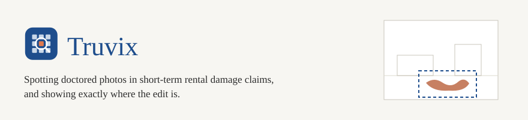
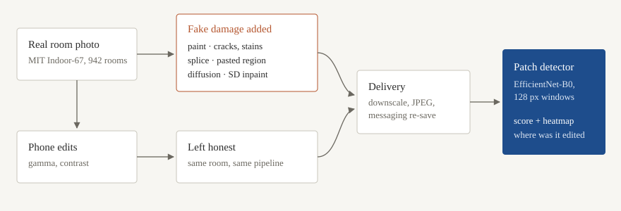
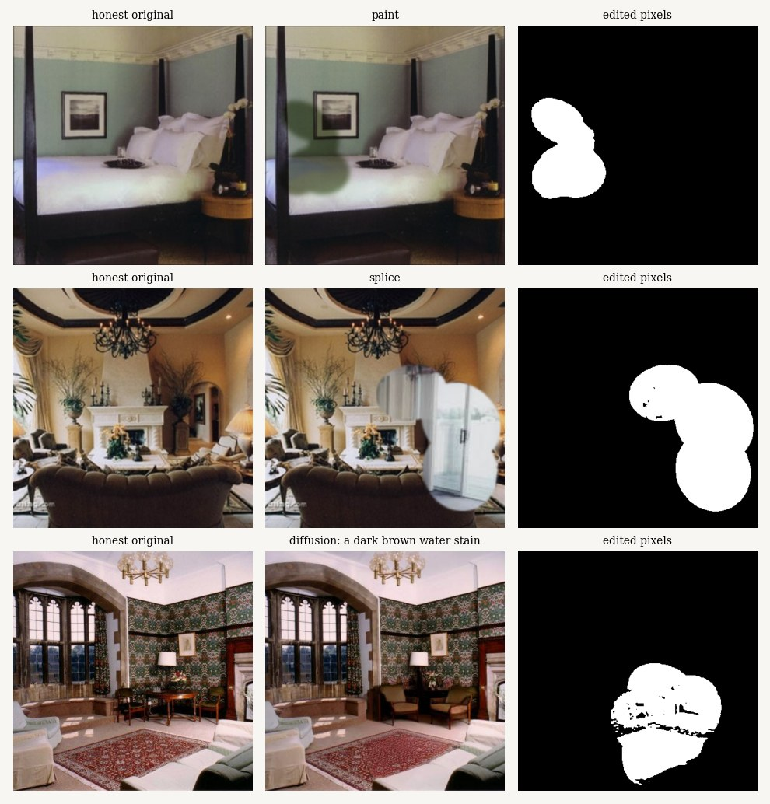
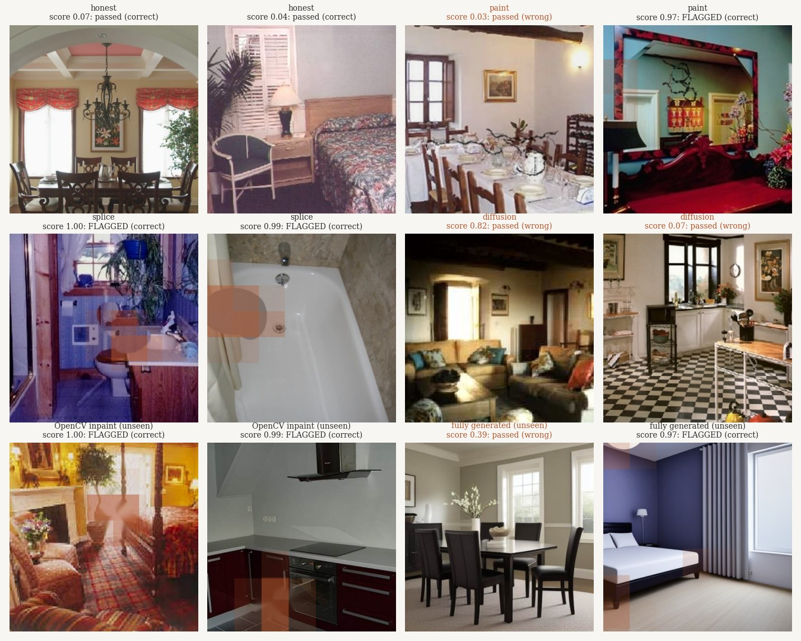

<p align="center"></p>

A host says the guest broke the table and sends a photo. Was the crack really there, or was it painted in, pasted in, or generated? ClaimShield scores a damage-claim photo for signs of local editing and draws a heatmap of where the edit is, so a reviewer looks at the right part of the picture before money moves.

**Start here:** [the illustrated guide (PDF, 14 pages)](docs/ClaimShield_Guide.pdf) · [open the notebook in Colab](https://colab.research.google.com/github/Kaushik-verse/claimshield/blob/main/colab/claimshield_colab.ipynb) (free T4, about 1.5 h end to end) · [results](#results) · [where it fails](#what-does-not-work)

## Why this exists

In October 2026 an Airbnb guest in Australia was billed about AU$1,700 for a "flooded bathroom". The photo had water that didn't splash, dry toilet paper, and reportedly a SynthID watermark. The claim was rejected after the guest posted it publicly ([Your Mileage May Vary, 21 Oct 2026](https://yourmileagemayvary.com/2026/10/21/airbnb-ai-damage-claim/)). In 2025 a London guest was charged for £12,000 of damage backed by allegedly doctored photos, and was refunded only on appeal ([The Guardian, 2 Aug 2025](https://www.theguardian.com/technology/2025/aug/02/airbnb-guest-damage-claim-refund-photos); [AI Incident Database #1161](https://incidentdatabase.ai/cite/1161/)). Airbnb's own June 2026 scam advisory reports that "62 percent of Americans believe AI-generated content is making scams more convincing" ([Airbnb Newsroom, 17 Jun 2026](https://news.airbnb.com/partnering-with-experts-on-tips-to-help-avoid-summer-travel-scams-in-u-s/)).

Both of those cases were caught by people squinting at pixels. This project asks how far a small model can get on that job, and where it fails.

## How it works

<p align="center"></p>

**Own dataset.** The project starts from 1,653 real photos of bedrooms, living rooms, bathrooms, kitchens and dining rooms (MIT Indoor-67). Every room is used twice: once left honest, and once with fake damage added. Both copies go through the same delivery pipeline: phone-style tone tweaks, a random downscale, JPEG at quality 65–95, and in 30% of cases a second messaging-app JPEG. The detector therefore can't learn "saved twice" or "different size" as a shortcut. Splits are made by room, so a room in the test set was never seen in training.

| Edit type | What it imitates | How it is made |
|---|---|---|
| paint | a phone photo editor | procedural cracks and tinted stains blended into a random region |
| splice | pasting damage from elsewhere | copy-move or a splice from another photo, darkened and feathered |
| diffusion | AI inpainting, the news case | Stable Diffusion 1.5 inpainting + LCM-LoRA (guidance 1.8, 8 steps) prompted with one of 10 damage types, pasted back inside the mask |
| OpenCV inpaint (test only) | an editing tool the model never saw | OpenCV Telea inpainting |
| fully generated (test only) | a whole fake photo, as in the Australian case | the same SD model with the entire frame masked, e.g. "a flooded bathroom with water all over the floor" |

**Every edit must be visible.** A fake claim photo has to show something, so each edit must visibly change at least 0.4% of the image, measured as the smoothed RGB difference against the honest copy. Otherwise it is retried with a new seed. The label mask is the set of pixels that actually changed. Retries were rare: 32 paint and 15 diffusion edits needed a new seed, and 1 diffusion edit was still too faint after 4 tries (`data/generation_stats.json`).

<p align="center"></p>

*One test example per edit type: the one with the largest edit, so the change is visible. The diffusion row was prompted with "a dark brown water stain" but mostly re-drew the chairs, which is typical of SD 1.5 inpainting.*

| split | honest | edited |
|---|---|---|
| train | 1,158 | 1,158 (384 paint · 386 splice · 388 diffusion) |
| validation | 165 | 165 |
| test | 330 | 330 (110 paint · 103 splice · 117 diffusion) |
| unseen tools (test rooms) | — | 330 OpenCV inpaint · 80 fully generated |

**Detector.** A CNN fine-tuned on 128 px windows, answering "were these pixels edited?". Sliding it over the photo gives a heatmap; the image score is the most suspicious window. Each training photo also gets one extra "laundered" copy (re-saved JPEG, downscaled, or screenshotted), so recompression is not mistaken for editing. Three ImageNet backbones were trained for 20 epochs each, and the one with the best validation score was kept. The test set played no part in that choice.

| backbone | best validation AUC |
|---|---|
| **EfficientNet-B0** (selected) | **0.814** |
| ResNet-50 | 0.796 |
| ResNet-18 | 0.788 |

**Baselines.** Error-level analysis (ELA) statistics + logistic regression, and SRM noise-residual statistics (Fridrich & Kodovsky) + logistic regression.

**Operating point.** A false flag accuses an honest host or guest, so the threshold is set on the validation split to flag at most 5% of honest photos. It is then frozen for the test set.

**Compute.** The full pipeline runs on a free Colab T4 in about 1.5 hours: 32 minutes to generate the dataset, then training and evaluation (`colab/claimshield_colab.ipynb`). On the 8 GB MacBook Air the Stable Diffusion step is impractical, at about 9 minutes per image: fp16 returns NaNs on Apple MPS, and fp32 does not fit in memory.

## Results

<p align="center"></p>

Held-out test set: 330 honest and 330 edited photos. Threshold frozen from validation. Brackets show 95% bootstrap intervals.

| detector | ROC-AUC | edited photos caught | honest photos flagged |
|---|---|---|---|
| ELA + logistic | 0.51 [0.47–0.55] | 2.1% | 2.4% |
| SRM noise + logistic | 0.53 [0.49–0.57] | 6.4% | 3.9% |
| **EfficientNet-B0 patch net** | **0.76 [0.73–0.80]** | **51.2%** | **8.5%** |

Patch net by edit type (honest photos flagged: 8.5% in every row):

| edit type | ROC-AUC | caught |
|---|---|---|
| splice | 0.95 [0.92–0.98] | 89.3% |
| diffusion | 0.68 [0.63–0.74] | 28.2% |
| paint | 0.68 [0.61–0.75] | 40.0% |
| OpenCV inpaint (never trained on) | 0.95 [0.94–0.97] | 86.1% |
| **fully generated photo** (never trained on) | **0.91 [0.88–0.94]** | **71.3%** |

Robustness: every test photo laundered once more after delivery.

| extra laundering | ROC-AUC | caught | honest flagged |
|---|---|---|---|
| none | 0.76 | 51.2% | 8.5% |
| re-saved at JPEG 50 | 0.74 | 46.1% | 7.9% |
| downscaled to half size | 0.67 | 19.1% | 2.4% |
| screenshot (upscale, blur) | 0.75 | 52.4% | 14.8% |

Localisation (pixel F1 of the heatmap at 0.5 against the true edit mask): splice 0.40, paint 0.15, diffusion 0.10.

<p align="center"></p>

*Twelve test photos, two per type, drawn at random with a fixed seed rather than hand-picked. Terracotta shading is the heatmap; red titles are mistakes. 8 of 12 are correct, which matches the rates above:*
- *Pasted regions and the unseen OpenCV inpainting are caught and localised.*
- *Missed: both diffusion edits, one faint paint edit, and one fully generated room.*

### Progress across versions

| | v1 | v2 | v3 |
|---|---|---|---|
| rooms | 942 | 942 | 1,653 |
| edit types trained on | paint, splice | + diffusion (guidance 1.0) | + visible-change check, guidance 1.8 |
| model | ResNet-18, 5 epochs | ResNet-18, 5 epochs | EfficientNet-B0, 20 epochs, laundering, chosen on validation |
| test AUC | 0.82 * | 0.73 | **0.76** |
| diffusion AUC | — | 0.59 | **0.68** |
| fully generated AUC | — | 0.81 | **0.91** |
| screenshot false flags | 12.8% | 29.3% | **14.8%** |

\* v1 had no diffusion edits, an easier task. Its number is not comparable with v2 and v3. All results are in `results/v1_paint_splice/`, `results/v2/` and `results/`.

## What does not work

- **Local AI inpainting is still the weak spot.** Diffusion edits are caught 28% of the time (AUC 0.68). Looking at the examples, Stable Diffusion rarely draws "damage" when asked to. It usually swaps in a plausible object, such as a jar, a towel or a new tap, and those edits look natural to people as well. Whole fake photos are much easier to spot (0.91) than small AI edits inside a real one.
- **False flags are above target.** The threshold aimed for ≤5% false flags on validation but produced 8.5% on test. A real deployment would need a larger validation set to set it reliably.
- **It does not transfer between editing tools.** Trained without each type and tested on it, the detector scores 0.54 (paint), 0.64 (splice) and 0.49 (diffusion). It recognises the tools it was trained on, not editing in general. The good score on unseen OpenCV inpainting (0.95) is most likely because that tool's smooth fill resembles feathered splices.
- **Classical forensics fail here.** After a downscale and a JPEG re-save, ELA and SRM statistics carry no usable signal (AUC 0.51–0.53).
- **Small images break it.** Halving the resolution drops recall to 19%.
- **The models memorise.** Training loss reaches 0.01–0.05 while validation AUC plateaus around 0.8. More real variety would help more than more epochs.
- **Synthetic damage is not real damage.** No genuinely damaged rooms are in the honest class. A real deployment would need honest damage photos, or the model may learn "damage = fake".
- **A score is not a verdict.** The output is meant to send a claim to a human reviewer, never to reject it automatically.

## Use it

```bash
python -m venv .venv && source .venv/bin/activate
pip install -e ".[dev]"            # add ".[generate]" for the diffusion family
python -m pytest -q tests                                       # 12 passed
python scripts/demo.py && open demo_output.png                  # heatmaps on 12 example photos
python -m claimshield.cli claim.jpg --heatmap claim_heatmap.png # your own photo
```

To rebuild everything, open `colab/claimshield_colab.ipynb` in Colab, choose a T4 and Run all (about 1.5 h). The notebook clones this repository, then runs each step in its own cell with a short explanation, and shows the result tables and heatmaps inline. `results/metrics.json` holds every number above. `data/manifest.csv` lists each image with its edit type, split, edit fraction, prompt and JPEG history.

## References

- Quattoni & Torralba, *Recognizing Indoor Scenes*, CVPR 2009 — base photos ([MIT Indoor-67](https://web.mit.edu/torralba/www/indoor.html), research use only).
- Fridrich & Kodovsky, *Rich Models for Steganalysis of Digital Images*, IEEE TIFS 2012 — SRM residual filters.
- He et al., *Deep Residual Learning for Image Recognition*, CVPR 2016, [arXiv:1512.03385](https://arxiv.org/abs/1512.03385).
- Tan & Le, *EfficientNet: Rethinking Model Scaling for Convolutional Neural Networks*, ICML 2019, [arXiv:1905.11946](https://arxiv.org/abs/1905.11946).
- Wang et al., *CNN-generated images are surprisingly easy to spot... for now*, CVPR 2020, [arXiv:1912.11035](https://arxiv.org/abs/1912.11035).
- Ojha et al., *Towards Universal Fake Image Detectors that Generalize Across Generative Models*, CVPR 2023, [arXiv:2302.10174](https://arxiv.org/abs/2302.10174) — why cross-generator generalisation is the hard part.
- Corvi et al., *On the detection of synthetic images generated by diffusion models*, ICASSP 2023, [arXiv:2211.00680](https://arxiv.org/abs/2211.00680).
- Guillaro et al., *TruFor: trustworthy image forgery detection and localization*, CVPR 2023, [arXiv:2212.10957](https://arxiv.org/abs/2212.10957).
- Rombach et al., *High-Resolution Image Synthesis with Latent Diffusion Models*, CVPR 2022, [arXiv:2112.10752](https://arxiv.org/abs/2112.10752); Luo et al., *LCM-LoRA*, [arXiv:2311.05556](https://arxiv.org/abs/2311.05556) — the generator used for the diffusion edits.
- Zhu et al., *GenImage: a million-scale benchmark for detecting AI-generated images*, NeurIPS 2023, [arXiv:2306.08571](https://arxiv.org/abs/2306.08571) — public benchmark for future comparison.

## Data, licences and attribution

| What | Source | Terms |
|---|---|---|
| Room photos | [MIT Indoor-67](https://web.mit.edu/torralba/www/indoor.html) (Quattoni & Torralba, CVPR 2009), via the [Hugging Face mirror](https://huggingface.co/datasets/NuclearUnicorn-UWC/mit-indoor-outdoor) | "for research purposes only"; downloaded at run time, not redistributed |
| Diffusion edits | [Stable Diffusion 1.5 inpainting](https://huggingface.co/stable-diffusion-v1-5/stable-diffusion-inpainting) + [LCM-LoRA](https://huggingface.co/latent-consistency/lcm-lora-sdv1-5) | CreativeML OpenRAIL-M / OpenRAIL++; weights not redistributed |
| Detector starting weights | torchvision ImageNet ResNet / EfficientNet | BSD-3-Clause code; ImageNet non-commercial research terms |
| Libraries | PyTorch, scikit-learn, OpenCV, Pillow, diffusers, transformers, … | BSD / Apache-2.0 / MIT (full list in [NOTICE.md](NOTICE.md)) |

- **Code: MIT** © 2026 Ch Kaushik ([LICENSE](LICENSE)).
- **The example photos in `docs/` and the trained weights in `models/` are derived from MIT Indoor-67. They are for research and education only** and are not covered by the MIT License. If you own one of the photos and want it removed, open an issue.
- The edited and generated images exist only to train and test a detector. They show no real claim, and must not be used to deceive anyone.
- **ClaimShield is an independent project. It is not affiliated with or endorsed by Airbnb, Inc.** The company is named only to cite public news reports.

Full details are in [NOTICE.md](NOTICE.md). If you use this work, please cite it ([CITATION.cff](CITATION.cff)) together with the papers above.
