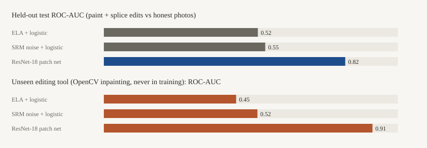
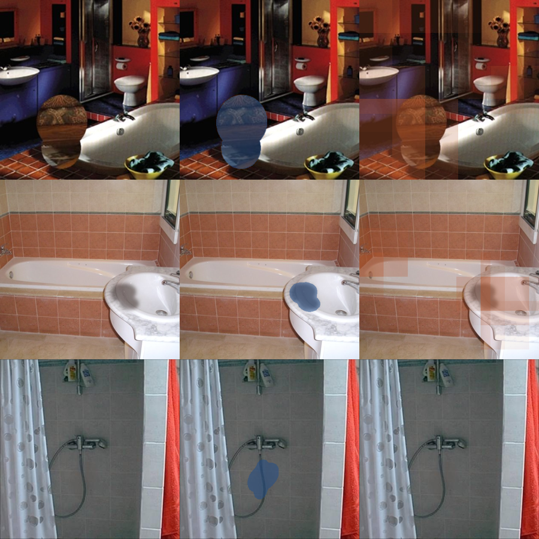

<p align="center"></p>

A host says the guest broke the table and sends a photo. Was the crack really there, or was it painted in, pasted in, or generated? ClaimShield scores a damage-claim photo for signs of local editing and draws a heatmap of where the edit is, so a reviewer looks at the right part of the picture before money moves.

## Why this exists

In October 2026 an Airbnb guest in Australia was billed about AU$1,700 for a "flooded bathroom". The photo had water that didn't splash, dry toilet paper, and reportedly a SynthID watermark. The claim was rejected after the guest posted it publicly ([Your Mileage May Vary, 21 Oct 2026](https://yourmileagemayvary.com/2026/10/21/airbnb-ai-damage-claim/)). In 2025 a London guest was charged for £12,000 of damage backed by allegedly doctored photos, and was refunded only on appeal ([The Guardian, 2 Aug 2025](https://www.theguardian.com/technology/2025/aug/02/airbnb-guest-damage-claim-refund-photos); [AI Incident Database #1161](https://incidentdatabase.ai/cite/1161/)). Airbnb's own June 2026 scam advisory reports that "62 percent of Americans believe AI-generated content is making scams more convincing" ([Airbnb Newsroom, 17 Jun 2026](https://news.airbnb.com/partnering-with-experts-on-tips-to-help-avoid-summer-travel-scams-in-u-s/)).

Both of those cases were caught by people squinting at pixels. This project asks how far a small model can get on that job, and where it fails.

## How it works

<p align="center"></p>

**Own dataset.** The project starts from 942 real photos of bedrooms, living rooms, bathrooms, kitchens and dining rooms (MIT Indoor-67). Every room is used twice: once left honest, and once with fake damage added. Both copies go through the same delivery pipeline: phone-style tone tweaks, a random downscale, JPEG at quality 65–95, and in 30% of cases a second messaging-app JPEG. The detector therefore can't learn "saved twice" or "different size" as a shortcut. Splits are made by room, so a room in the test set was never seen in training.

| Edit type | What it imitates | How it is made |
|---|---|---|
| paint | a phone photo editor | procedural cracks and tinted stains blended into a random region |
| splice | pasting damage from elsewhere | copy-move or a splice from another photo, darkened and feathered |
| diffusion | the news case: AI-added damage | Stable Diffusion 1.5 inpainting + LCM-LoRA, prompted with one of 10 damage types ("a dark brown water stain", "a hole punched in the wall", …), pasted back inside the mask |
| OpenCV inpaint (test only) | an editing tool the model never saw | OpenCV Telea inpainting |
| fully generated (test only) | a whole fake photo, as in the Australian case | the same SD model with the entire frame masked, e.g. "a flooded bathroom with water all over the floor" |

| split | honest | edited |
|---|---|---|
| train | 660 | 660 (217 paint · 214 splice · 229 diffusion) |
| validation | 94 | 94 |
| test | 188 | 188 (64 paint · 64 splice · 60 diffusion) |
| unseen tools | — | 188 OpenCV inpaint · 60 fully generated |

The diffusion edits were generated on a free Colab T4 (11 minutes for the whole dataset). On the 8 GB MacBook Air the same step took about 9 minutes per image: fp16 returns NaNs on Apple MPS, and fp32 does not fit in memory. `colab/claimshield_colab.ipynb` reproduces the whole run.

**Detector.** An ImageNet ResNet-18 fine-tuned on 128 px windows, answering "were these pixels edited?". Sliding it over the photo gives a heatmap; the image score is the most suspicious window. Five epochs take under a minute on a T4, or about 2.5 minutes on the M2.

**Baselines.** Error-level analysis (ELA) statistics + logistic regression, and SRM noise-residual statistics (Fridrich & Kodovsky) + logistic regression.

**Operating point.** A false flag accuses an honest host or guest, so the threshold is set on the validation split to flag at most 5% of honest photos. It is then frozen for the test set.

## Results

<p align="center"></p>

Held-out test set, threshold frozen from validation.

| detector | ROC-AUC | edited photos caught | honest photos flagged |
|---|---|---|---|
| ELA + logistic | 0.50 | 2.1% | 2.7% |
| SRM noise + logistic | 0.52 | 3.7% | 4.8% |
| **ResNet-18 patch net** | **0.73** | **37.8%** | **6.4%** |

Patch net by edit type (honest photos flagged: 6.4% in every row):

| edit type | ROC-AUC | caught |
|---|---|---|
| splice | 0.91 | 67.2% |
| paint | 0.69 | 32.8% |
| **diffusion** | **0.59** | **11.7%** |
| OpenCV inpaint (never trained on) | 0.96 | 84.6% |
| fully generated photo (never trained on) | 0.81 | 46.7% |

Robustness: every test photo laundered once more after delivery.

| extra laundering | ROC-AUC | caught | honest flagged |
|---|---|---|---|
| none | 0.73 | 37.8% | 6.4% |
| re-saved at JPEG 50 | 0.73 | 27.7% | 3.2% |
| downscaled to half size | 0.63 | 10.6% | 0.5% |
| screenshot (upscale, blur) | 0.71 | 58.5% | 29.3% |

Localisation (pixel F1 of the heatmap at 0.5 against the true edit mask): splice 0.30, diffusion 0.16, paint 0.14.

<p align="center"></p>

*Left: claim photo. Middle: true edit in blue. Right: ClaimShield's heatmap in terracotta. Rows, top to bottom: pasted region (flagged, score 0.994), painted stain on the sink (flagged, 0.998), diffusion "water stain" on the shower wall (missed, 0.17).*

## What does not work

- **AI inpainting is the weak spot.** Diffusion edits, the attack that motivated the project, are caught only 11.7% of the time (AUC 0.59). Part of this is the generator itself: at guidance 1.0, LCM-LoRA often fills the mask with plausible wall or floor rather than visible damage. The bottom example above shows that; a person cannot see that edit either. A stronger prompt-following setup (guidance 1.5–2, more steps) would make a fairer and harder test. That is the next experiment.
- **Adding diffusion made the other numbers worse.** With only paint and splice edits (v1, `results/v1_paint_splice/`), the same model scored 0.82 AUC with 1.6% false flags. Mixing in near-invisible diffusion edits lowers it to 0.73 with 6.4% false flags. The validation-set threshold also overshoots the 5% target on test.
- **It does not transfer between editing tools.** Trained without each family and tested on it, the patch net scores 0.62 (paint), 0.64 (splice) and 0.54 (diffusion). The strong score on unseen OpenCV inpainting (0.96) is probably because that tool's smooth fill looks like the feathered splices. It is not evidence of general edit detection.
- **Classical forensics fail here.** After a downscale and a JPEG re-save, ELA and SRM statistics carry no usable signal (AUC 0.50–0.52).
- **Screenshots and small images break it.** A screenshot pushes false flags to 29%. Halving the resolution drops recall to 11%.
- **Synthetic damage is not real damage.** No genuinely damaged rooms are in the honest class. A real deployment would need honest damage photos, or the model may learn "damage = fake".
- **A score is not a verdict.** The output is meant to send a claim to a human reviewer, never to reject it automatically.

## Use it

```bash
python -m venv .venv && source .venv/bin/activate
pip install -e ".[dev]"            # add ".[generate]" for the diffusion family
python -m claimshield.cli claim.jpg --heatmap claim_heatmap.png
```

To rebuild everything, either run `colab/claimshield_colab.ipynb` on a T4 (about 25 minutes), or run `./run_all.sh` on a laptop, which skips diffusion unless `DIFFUSION=1` is set. `results/metrics.json` holds every number above. `data/manifest.csv` lists each image with its edit type, split, edit fraction, prompt and JPEG history.

## References

- Quattoni & Torralba, *Recognizing Indoor Scenes*, CVPR 2009 — base photos (MIT Indoor-67).
- Fridrich & Kodovsky, *Rich Models for Steganalysis of Digital Images*, IEEE TIFS 2012 — SRM residual filters.
- He et al., *Deep Residual Learning for Image Recognition*, CVPR 2016, [arXiv:1512.03385](https://arxiv.org/abs/1512.03385).
- Wang et al., *CNN-generated images are surprisingly easy to spot... for now*, CVPR 2020, [arXiv:1912.11035](https://arxiv.org/abs/1912.11035).
- Ojha et al., *Towards Universal Fake Image Detectors that Generalize Across Generative Models*, CVPR 2023, [arXiv:2302.10174](https://arxiv.org/abs/2302.10174) — why cross-generator generalisation is the hard part.
- Corvi et al., *On the detection of synthetic images generated by diffusion models*, ICASSP 2023, [arXiv:2211.00680](https://arxiv.org/abs/2211.00680).
- Guillaro et al., *TruFor: trustworthy image forgery detection and localization*, CVPR 2023, [arXiv:2212.10957](https://arxiv.org/abs/2212.10957).
- Rombach et al., *High-Resolution Image Synthesis with Latent Diffusion Models*, CVPR 2022, [arXiv:2112.10752](https://arxiv.org/abs/2112.10752); Luo et al., *LCM-LoRA*, [arXiv:2311.05556](https://arxiv.org/abs/2311.05556) — the generator used for the diffusion edits.
- Zhu et al., *GenImage: a million-scale benchmark for detecting AI-generated images*, NeurIPS 2023, [arXiv:2306.08571](https://arxiv.org/abs/2306.08571) — public benchmark for future comparison.

## Licence

MIT © Ch Kaushik
